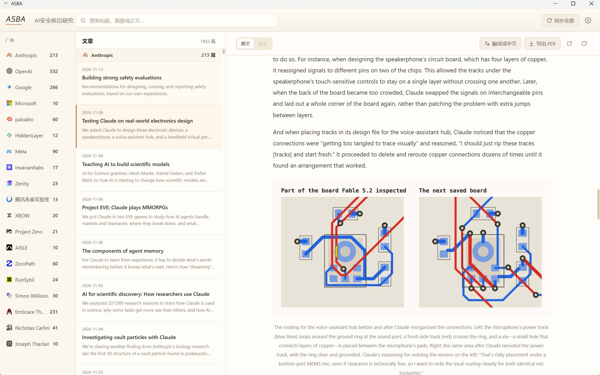
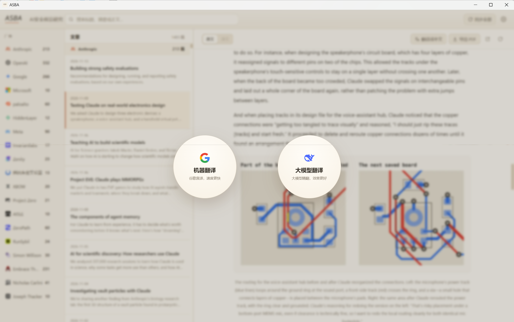
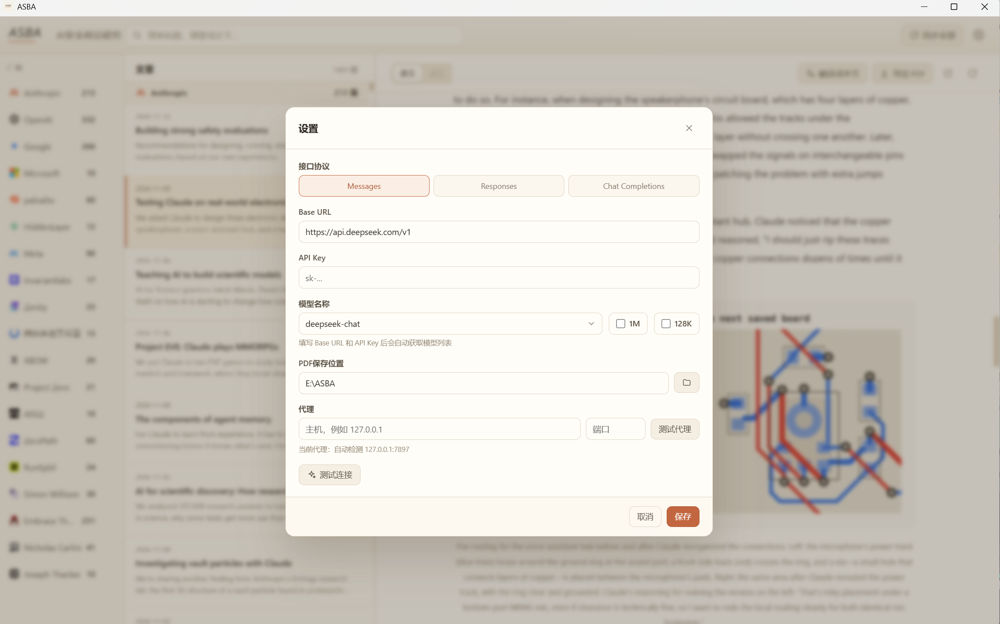

<h1 align="center">ASBA</h1>

<strong>AI安全前沿研究聚合台</strong>

  
  

## 我们的初衷

作为网络安全从业者，我们希望借助AI的力量，开发出更多实用性的架构或工具，推动行业不断向前发展！如果您喜欢我们的产品，麻烦点个⭐哦~

## 效果展示

主页面

翻译选项

设置页面

## 免责声明

❗ ASBA是一个AI安全前沿研究文章的聚合工作台。文章版权归原作者及原发布机构所有，使用时应遵守来源站点的服务条款、版权声明及适用的法律法规。请勿将本项目用于未经授权的抓取、传播或商业使用。

❗ ASBA的译文、摘要及导出内容由第三方翻译服务或用户配置的大模型生成，可能存在错误、遗漏或偏差，不构成任何专业建议。涉及安全研究、漏洞披露或生产决策时，请以原文和官方信息为准，并自行核实。

❗ 用户应自行确认同步范围、API服务条款、费用及数据合规要求，并妥善保管自己的API Key、代理配置和本地数据。开发者与贡献者不承担任何因使用或滥用本项目造成的直接或间接损失及相关法律责任。

## ⚖️ 许可证

本项目采用 AGPL-3.0，允许个人研究及商业使用。当分发软件或通过网络向他人提供修改版本时，须按许可证要求提供相应源码、保留版权与许可声明，具体以许可证全文为准！

<strong>商业授权：</strong>如希望在不承担AGPL-3.0相应开源义务的条件下用于商业或闭源产品，请联系项目维护者，就其有权另行许可的代码取得书面商业授权。遵守AGPL-3.0的商业使用无需额外授权。

<strong>贡献说明：</strong>提交Pull Request即表示你有权提交相关内容，并同意项目维护者将你的贡献分别按AGPL-3.0及其他商业许可条款对外授权。贡献者保留其著作权。

<strong>第三方内容与组件：</strong>ASBA聚合的文章、图片、商标及站点图标归各自权利人所有，不因本项目采用AGPL-3.0而改变其授权状态；项目使用的第三方开源组件仍遵循各自的许可证，商业授权不改变第三方组件的许可证义务。
